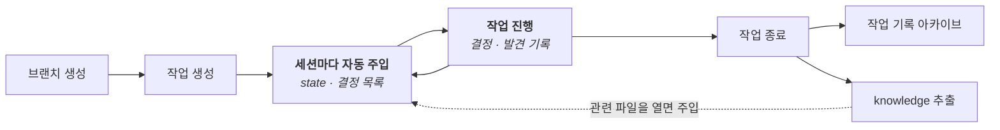
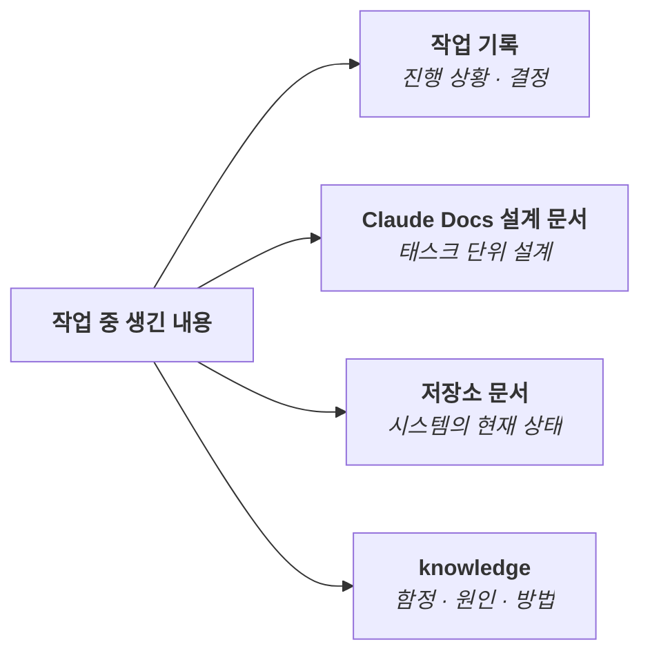

# agent-desk

**Claude Code가 어제 하던 일을 기억하게 하는 플러그인.**

진행상황, 결정, 발견을 작업 단위로 기록해 맥락을 보존하고, 세션을 열면 그 맥락을 에이전트에게 자동으로 주입해줍니다.

- 새 세션마다 "어디까지 했고 왜 이렇게 했는지" 다시 설명하지 않아도 됩니다.
- 이미 기각한 대안을 에이전트가 다시 꺼내지 않습니다.
- 한 번 밟은 함정은 그 코드를 다시 열 때 자동으로 알려줍니다.

## 설치

Python 3.11 이상과 git이 필요합니다.

```
claude plugin marketplace add Othereum/agent-desk
claude plugin install agent-desk@agent-desk
```

## 핵심 개념

### 작업(task)

작업은 "로그인 기능 구현", "저장 버그 수정"처럼 하나의 목표를 가진 일이고, agent-desk의 기록은 모두 작업 단위로 나뉘어 저장됩니다. 작업마다 세 가지를 남깁니다. **지금 어디까지 했는지**(state), **무엇을 왜 정했는지**(decisions), **무엇을 알아냈는지**(log)입니다.

브랜치마다 작업이 하나씩 붙고, 브랜치를 바꾸면 에이전트가 아는 맥락도 그 작업으로 바뀌어 여러 일의 기록이 섞이지 않습니다. 브랜치 없이 `main`에서만 일한다면 브랜치 없는 작업을 만들면 되고, 이 작업이 포커스가 되어 같은 방식으로 이어집니다.

```
git 브랜치                 agent-desk 작업
─────────────              ─────────────────────────────────────────────
feature/login   ───▶       tasks/261016-feature__login/
                             ├─ state.md       지금 어디까지, 다음에 할 일
                             ├─ decisions.md   무엇을 왜 정했나 (기각한 대안 포함)
                             └─ log.md         무엇을 알아냈나
fix/crash       ───▶       tasks/261016-fix__crash/
main            ···▶       포커스 작업 (브랜치 없이 main에서 일할 때)
```

**세션을 열면** 현재 작업의 기록이 에이전트에게 자동으로 주입됩니다.

```
[agent-desk] 프로젝트 myapp · 브랜치 feature/login · 작업 261016-feature__login (active)

--- state.md ---
## 현재 상태
- 로그인 API 완료, 토큰 갱신 로직 작업 중
## 다음 할 일
- 만료 직전 토큰 갱신 테스트 추가

--- 결정 목록 (본문은 decisions.md) ---
- D1. 세션 캐시는 메모리 대신 Redis 사용  (2026-10-16, 유효)
```

### knowledge

knowledge는 작업이 끝나도 계속 유효한 **코드에 대한 사실**입니다. 작업 기록이 "이 일을 어디까지 했나"라면, knowledge는 "이 코드는 이렇다"입니다.

- 항목 하나에 사실 하나를 담습니다. 종류는 설계 결정(decision), 함정(pitfall), 원인이나 동작 방식(finding), 반복되는 절차(howto)입니다.
- 작업이 아니라 **코드 경로**(`src/auth/**` 같은 glob)에 붙습니다. 그래서 어떤 작업에서든 그 경로의 파일을 읽거나 고치면 자동으로 나타납니다.
- 프로젝트를 가리지 않는 사실(도구, OS, 셸 등)은 전역 knowledge로 남기고, 필요할 때 검색으로 찾습니다.
- 주로 작업을 마칠 때 추려 내지만, 함정이나 원인은 발견한 즉시 기록을 제안합니다.
- 코드가 바뀌어 낡은 항목은 `doctor`가 커밋 이력을 보고 찾아내 "재확인 필요"로 표시합니다.

**한 달 뒤, 다른 작업에서 관련 파일을 열면** 그때 남긴 함정이 나타납니다.

```
[agent-desk knowledge] src/auth/session.ts 관련 항목:
- K0012 (pitfall) 세션 토큰 캐시는 설정 리로드 시 초기화되지 않는다 · 근거: src/auth/session.ts:42
```

### 작업에서 knowledge로



### 기록이 가는 곳



설계 문서는 그 작업이 진행된 시점의 판단을, 저장소 문서는 코드와 함께 고쳐지는 현재 상태를 담습니다. 어디에 둘지는 에이전트가 기준에 따라 제안하고 사용자가 승인합니다.

## 사용법

저장소에서 Claude Code를 열고 아래 순서로 씁니다.

```
/agent-desk:desk-init     저장소 등록 (한 번)
/agent-desk:desk-new      작업 시작
                          … 평소처럼 일하기 (기록은 에이전트가 제안)
/agent-desk:desk-close    작업 종료, knowledge 추출
```

## 데이터 구조

기록은 모두 사람이 읽고 고칠 수 있는 Markdown 파일이고, 플러그인과 분리된 데이터 폴더(`AGENT_DESK_ROOT`)에 쌓입니다.

```
<AGENT_DESK_ROOT>/
├─ desk.toml                          스키마 버전
├─ knowledge/G0001-*.md               전역 knowledge (프로젝트 무관, 태그로 매칭)
└─ projects/<KEY>/                    저장소 하나 = 프로젝트 하나
    ├─ project.toml                   프로젝트 설정 (원격 URL, ID 규칙, 공용 브랜치)
    ├─ index.md                       작업 목록 (자동 생성)
    ├─ focus.txt                      포커스 작업 ID
    ├─ tasks/<id>/                    진행 중인 작업
    │   ├─ state.md                     현재 상태 (덮어씀)
    │   ├─ decisions.md                 결정 (항목 추가)
    │   └─ log.md                       히스토리 (덧붙이기만)
    ├─ archive/<id>/                  종료된 작업
    └─ knowledge/K0001-*.md           프로젝트 knowledge (경로 glob으로 매칭)
```

## 설정

**데이터 폴더.** 환경 변수 `AGENT_DESK_ROOT`로 지정하고, 지정하지 않으면 `~/agent-desk`를 씁니다. `~/.claude/settings.json`의 `env`에 넣으면 Claude Code 세션에 적용됩니다.

```json
{ "env": { "AGENT_DESK_ROOT": "C:/Users/<you>/<동기화 폴더>/agent-desk" } }
```

클라우드 동기화 폴더에 두면 여러 PC에서 같은 기록을 쓸 수 있습니다.
- 폴더의 파일이 항상 로컬에 내려받아져 있도록(온디맨드 동기화 해제) 설정하세요. 그렇지 않으면 hook이 파일을 읽을 때 지연되거나 실패할 수 있습니다.
- 데이터 폴더 안에서 `git init`을 하지 마세요. 동기화 폴더 안의 `.git`은 손상되기 쉽습니다.
- 두 PC에서 같은 파일을 동시에 고쳐 충돌 사본이 생기면 세션 시작과 `doctor`가 알려 줍니다.

**저장소별 데이터 폴더.** 회사 일과 개인 프로젝트처럼 기록을 나누고 싶다면, 그 저장소의 `.claude/settings.local.json`에 `AGENT_DESK_ROOT`를 넣습니다. 그 저장소에서 연 세션에서는 이 값이 사용자 설정을 덮어씁니다. 개인 경로가 들어가므로 이 파일은 커밋하지 마세요.

```json
{ "env": { "AGENT_DESK_ROOT": "C:/Users/<you>/<개인 동기화 폴더>/agent-desk" } }
```

## 더 알아보기

세부 동작과 규칙은 에이전트가 따르는 스킬에 있습니다.

- [`desk`](skills/desk/SKILL.md): 작업 생성 기준, 기록 규칙, 포커스와 상위 작업, 문서 위치 기준
- [`kn`](skills/kn/SKILL.md): knowledge 형식, 기록·수정 규칙, doctor
- [`desk-new`](skills/desk-new/SKILL.md) · [`desk-close`](skills/desk-close/SKILL.md) · [`desk-init`](skills/desk-init/SKILL.md): 절차
- CLI: `python bin/desk.py --help`

## 라이선스

[MIT](./LICENSE)
